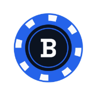
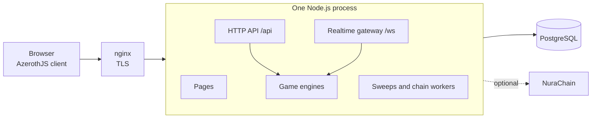

<div align="center">



# Baziche

**Chess, Hokm, Poker, Backgammon and Ludo at live tables,<br />with friends, groups, voice, and chat that is encrypted end to end.**

[](LICENSE)
[](package.json)


[Quick start](#quick-start) · [How it works](#how-it-works) · [Documentation](#documentation) · [Contributing](.github/CONTRIBUTING.md)

</div>


Baziche (بازیچه, Persian for *plaything*) is a social game platform for the games people play at a
real table. The server deals, rolls and rules on every move, so every player and every watcher sees
the same game and no client can choose its own dice. It is one TypeScript codebase: a Node.js server
with PostgreSQL and a WebSocket gateway, and a browser client built on
[AzerothJS](https://github.com/AzerothJS/AzerothJS).

> [!NOTE]
> **Pre-release.** Everything below is built and tested, and the whole stack runs from a clean clone,
> but there are no tagged versions or migrations yet, and the NuraChain contracts behind paid play
> have not had an independent audit. Expect breaking changes, and do not put real money through it.

## Highlights

- **Five games, refereed by the server.** Each is a pure engine behind one interface, and each seat
  and each watcher is sent only what it may see.
- **Tables and quick play.** A table for anybody, for friends, for whoever is invited or for a group's
  chat; quick play for people looking for the same game; live watching; Elo ratings, leaderboards,
  levels and achievement ladders.
- **Chat sealed in the browser** (`nura-e2ee/v1`): AES-256-GCM under one key per membership epoch,
  each line signed by the device that wrote it, with replies, reactions, edits, read receipts,
  disappearing messages and voice messages. The server stores ciphertext.
- **Voice at the table** over WebRTC, relayed by the server when a direct line will not connect, with
  noise suppression, push to talk and a volume for each person. Encrypted on its way, not end to end.
- **A wallet is the account.** One signature signs a person in and authorises that browser's message
  keys. There are no passwords.
- **NuraChain, where a server switches it on:** stakes on a game through `ArcadeVault`, with dice and
  cards anyone can check afterwards; a shop of looks through `ArcadeShop`; donations to a player
  through `ArcadeTips`; and pools on a game's outcome through `ArcadeMarkets`.
- **Run by its own staff:** moderator, admin and owner roles, a log of every change with its reason,
  alerts, Prometheus metrics, and a check of the database against NuraChain every minute.
- **Ten languages, phone first**, Persian and Arabic right to left, with a three.js landing page that
  paints a picture of its own first frame before any of it loads.

| Game | Players | Pace |
|---|---|---|
| Chess | 2 | live with a clock, 3+2 to 30+0, or a move a day |
| Hokm | 2, 3 or 4, the four as two against two | live, or a move a day |
| Poker | any number from 2 to 9 | live: no-limit Texas Hold'em, as a sit-and-go |
| Backgammon | 2 | live, or a move a day: matches to 1, 3 or 5 points, with the cube |
| Ludo | 2, 3 or 4, or two against two | live, or a move a day |

The rules each engine plays, with their sources, are in [docs/games](docs/games).

## Quick start

You need Node.js 24.11 or newer, PostgreSQL with the `citext` and `pgcrypto` extensions, and a
browser wallet such as MetaMask.

```sh
git clone https://github.com/NuraChain/BaziChe.git
cd BaziChe
npm ci
npm run dev          # http://localhost:3100
```

The first run asks which database to use (Enter takes `baziche` on your local Postgres), creates it,
and writes `.env`. Open the page, press **Connect wallet** and sign.

> [!TIP]
> A development database comes with six people who know each other: `dana.w`, `omid.k`, `sara.k`,
> `reza.t`, `mina` and `leila.a`. Their wallets are Hardhat's published test accounts 0 to 5, with
> the keys in [`wallet-fixtures.ts`](backend/src/db/wallet-fixtures.ts): import one into your wallet
> to sign in as that person, and another into a second browser profile to play against yourself.
> Those keys are public, so never send anything of value to them.

To run it the way a server does, `npm run build` and then `npm start`, on http://localhost:4900. To
host it for other people, follow [self-hosting](docs/operations/self-hosting.md).

## How it works



- **One process for each database.** Who is online, quick play's waits, calls and every live update
  are kept by the process that holds a player's connection. In a load test on one desktop, one
  process held 3,000 sockets and greeted 95% of them within 62 ms
  ([the socket audit](docs/design/2026-10-28-socket-audit.md)).
- **Games behind one interface.** An engine has no I/O, no clock and no randomness of its own: the
  server hands it the dice, so no client can choose them, and every board is composed for the seat
  that will see it.
- **The wire is declared once**, in `backend/src/schemas.ts`, and the browser's client is typed from
  that declaration.
- **The schema is the entities.** TypeORM entities are the only description of the database, and
  `syncSchema()` builds it from them; there are no migrations until something ships.
- **The browser** uses AzerothJS single-file components with signals and no virtual DOM. Pages load
  as they are needed, the landing page is prerendered in every language, and the build fails when a
  page outgrows its budget.

<details>
<summary><b>The engine interface</b></summary>

<br />

Abridged from [`backend/src/domains/match/engine.ts`](backend/src/domains/match/engine.ts):

```ts
export interface Engine<S = unknown, A = unknown>
{
    readonly id: string;

    create(seats: readonly number[], draws: Draws, table: TableConfig): Opened<S>;
    parse(play: MatchPlay, seat: number): A | null;
    apply(state: S, action: A, draws: Draws, moment?: Moment): Applied<S, unknown>;
    legal(state: S, seat: number): A[];
    turnOf(state: S): number | null;
    autoplay(state: S, seat: number, draws: Draws): A | null;
    finish(state: S): Ending | null;
    view(state: S, seat: number | null): MatchBoard;
    log(events: readonly unknown[], seat: number | null): MatchLog;

    // ...forfeit, standings, tally and points, its formats and sides, and optional hooks for a
    // clock, a pause after a hand and resigning
}
```

`apply` never throws: a refused move is a value, so the sweep that plays for somebody who ran out of
time can fold actions over a state. Every state carries its revision, which a database constraint
holds to its row. Randomness arrives as `draws`, taken by the server inside the transaction, and a
spec fails any engine whose source names a `node:` module, `crypto`, `Math.random` or `Date.now`.
`view` and `log` compose what one seat may see, so a Hokm hand or a poker player's hole cards are
never built into a payload that seat may not have.

</details>

## Development

| Command | What it does |
|---|---|
| `npm run dev` | the api on 4900, rebuilt on every change, and Vite on 3100 |
| `npm run check` | typecheck and lint both workspaces, then typecheck the server's specs |
| `npm test` | every unit spec, with no database |
| `npm run test:shuffle` | the same, in random order |
| `npm run test:db --workspace backend` | the database specs, against `TEST_DATABASE_URL`, which they empty |
| `npm run build` | the server, the client, the prerendered pages, and the size budgets |
| `npm start` | the built server: api, realtime and pages on one origin |
| `npm run qa` | the responsive matrix, Playwright across the app's pages at many sizes |

The art, the sounds, the shop's looks and the 3D scenes are generated by scripts in `tools/` and
committed (`npm run art`, `looks`, `sound`, `voices`, `beds`, `poster`, `assets`); some need Chrome,
ffmpeg or Blender 5.2. [CONTRIBUTING](.github/CONTRIBUTING.md) has the checks a change passes and
the conventions it follows.

## Configuration

One `.env` at the root holds everything, and every name in [`.env.example`](.env.example) must be
written; `npm run setup` writes one for your machine. Development or production follows from the
command, never from the file.

<details>
<summary><b>What the names are</b></summary>

<br />

| Names | What they are |
|---|---|
| `DATABASE_URL`, `SESSION_SECRET`, `PUBLIC_ORIGIN` | the database, the secret that signs sessions, the address people use |
| `HOST`, `PORT`, `API_RATE_MAX`, `DATABASE_POOL_MAX` | where it listens, requests a minute from one address, the database pool |
| `ADMIN_WALLET_ADDRESS` | the wallet that opens `/admin` as its owner |
| `VAPID_PUBLIC_KEY`, `VAPID_PRIVATE_KEY`, `VAPID_SUBJECT` | Web Push; empty, notifications stay in the app |
| `NURA_CHAIN_ID`, `NURA_RPC_URL`, `NURA_PROFILE_ADDRESS`, `NURA_PROFILE_LENS_ADDRESS`, `NURA_EXPLORER_API` | NuraChain: smart-contract wallets, on-chain profiles and NFTs |
| `NURA_VAULT_ADDRESS`, `NURA_SHOP_ADDRESS`, `NURA_TIPS_ADDRESS`, `NURA_MARKETS_ADDRESS`, `NURA_REFEREE_KEY` | paid tables, the shop, donations and markets |
| `METRICS_TOKEN` | Prometheus metrics at `/api/metrics`; empty, off |

The example's NuraChain values are the public NuraChain deployment: a fresh `.env` reads on-chain
profiles and offers donations, while paid tables, the shop and markets stay off without the server's
key. Write the NuraChain names empty to run with no chain at all.

</details>

## Documentation

| Where | What |
|---|---|
| [docs/games](docs/games) | each game's rules as its engine plays them |
| [docs/operations](docs/operations) | [self-hosting](docs/operations/self-hosting.md), [updates and backups](docs/operations/rollout.md), [runbooks](docs/operations/runbooks.md), [before real money](docs/operations/mainnet.md), [compliance](docs/operations/compliance.md) |
| [docs/looks.md](docs/looks.md), [docs/vfx.md](docs/vfx.md) | how the shop's looks are drawn, and the effects engine |
| [docs/design](docs/design) | design documents and audits, each with its decisions |

## Roadmap

- **In progress:** a pass over feedback across the whole app
  ([its ledger](docs/design/2026-11-01-ux-audit.md)): forms and their field errors, long
  lists, empty states, the app-wide fallbacks, and accessibility.
- **Before real money:** the steps in [mainnet.md](docs/operations/mainnet.md), from a server key of
  its own and a multisig to an independent audit and a legal review.
- **Later:** seasonal collections in the shop, such as Nowruz and Yalda.

## Contributing

Contributions are welcome, from a better sentence in one of the ten languages to a sixth game:
[CONTRIBUTING](.github/CONTRIBUTING.md) says how. Bugs and ideas go to the
[issues](https://github.com/NuraChain/BaziChe/issues), and a security problem goes to
[SECURITY](.github/SECURITY.md), never to an issue.

## License

[MIT](LICENSE). The recordings and music are CC0, credited in
[`tools/art/sound-src`](tools/art/sound-src/LICENSE.txt) and
[`tools/art/bed-src`](tools/art/bed-src/LICENSE.txt); the language menu's flags are from flag-icons,
MIT ([`frontend/public/flags`](frontend/public/flags/LICENSE)).

Built on [AzerothJS](https://github.com/AzerothJS/AzerothJS), [three.js](https://threejs.org),
[TypeORM](https://typeorm.io), [viem](https://viem.sh), [Tailwind CSS](https://tailwindcss.com),
[Vite](https://vite.dev), [Vitest](https://vitest.dev) and [Playwright](https://playwright.dev),
with [Lucide](https://lucide.dev) icons, [Inter](https://rsms.me/inter/) and
[Vazirmatn](https://github.com/rastikerdar/vazirmatn) type, and
[RNNoise](https://github.com/xiph/rnnoise) through
[web-noise-suppressor](https://github.com/sapphi-red/web-noise-suppressor); sounds from
[Kenney](https://kenney.nl), [BigSoundBank](https://bigsoundbank.com) and composers on
[OpenGameArt](https://opengameart.org); 3D scenes from [Blender](https://www.blender.org).
