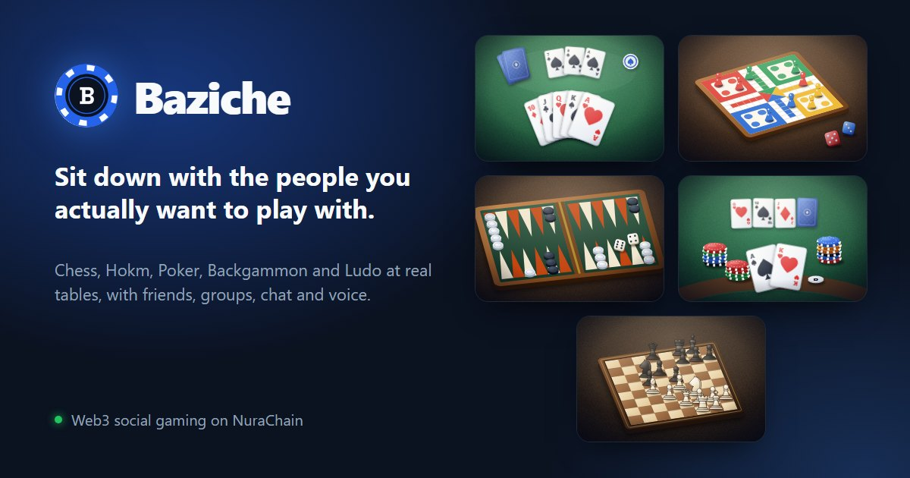
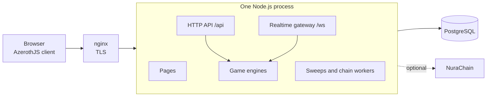

# Baziche

Chess, Hokm, Poker, Backgammon and Ludo at live tables, with friends, groups, voice, and chat that
is encrypted end to end.

[](LICENSE)
[](package.json)



Baziche (بازیچه, Persian for *plaything*) is a social game platform for the games people play at a
real table. The server deals, rolls and rules on every move, so every player and every watcher sees
the same game and no client can choose its own dice. Around the tables are friends, groups, chat
sealed in the browser, voice at the table, notifications, and ratings and achievements counted from
games that were actually played. People sign in with a browser wallet, and the parts that move NURA
on [NuraChain](https://github.com/NuraChain) (stakes on a game, a shop, donations to players, and pools on
a game's outcome) are switched on only on a server that is given their contracts.

It is one TypeScript codebase in two npm workspaces: a Node.js server with PostgreSQL and a
WebSocket gateway, and a browser client built on [AzerothJS](https://github.com/AzerothJS/AzerothJS).
You can run it on your own machine with one command, host it for your own players behind nginx, or
read it for how a realtime game platform with a server-side referee fits together.

## Status

**Pre-release.** Everything this README describes is built and has tests, and the whole stack runs
from a clean clone, but nothing has been released yet: there are no tagged versions, and no
migrations, so a self-hosted database is brought up to date in place, after a dump. The NuraChain
contracts behind paid play have not had an independent audit. Expect breaking changes, and do not
put real money through it yet.

**Contents:** [What's inside](#whats-inside) · [Quick start](#quick-start) ·
[How it works](#how-it-works) · [Repository layout](#repository-layout) ·
[Development](#development) · [Configuration](#configuration) ·
[Running it in production](#running-it-in-production) · [Documentation](#documentation) ·
[Roadmap](#roadmap) · [Contributing](#contributing) · [Security](#security) · [License](#license)

## What's inside

**Five games, refereed by the server.** Each game is a pure engine behind one interface
([below](#games-behind-one-interface)). A move is a request: the engine applies it inside a
database transaction, and each seat and each watcher is sent only what it may see. The rules every
engine plays, with their sources, are written out in [docs/games](docs/games).

| Game | Players | Pace | Rules |
|---|---|---|---|
| Chess | 2 | live with a clock (3+2 to 30+0), or a move a day | the FIDE Laws; draws by stalemate, repetition, the fifty-move rule, insufficient material and agreement |
| Hokm | 2, 3 or 4, the four as two against two | live, or a move a day | [Pagat's](https://www.pagat.com/whist/hokm.html), a match to 7 or 13 |
| Poker | 2, 6 or 9 | live | no-limit Texas Hold'em, played as a sit-and-go |
| Backgammon | 2 | live, or a move a day | a match to 1, 3 or 5 points, with the doubling cube |
| Ludo | 2, 3 or 4, or two against two | live, or a move a day | the common Iranian rules (منچ) |

**Tables, quick play and watching.** A table is opened from a game's page, with its seats, pace and
options, for anybody, for friends, for whoever is invited, or for the chat or group it was opened
from. Quick play seats people looking for the same game together. Moves are pushed to every seat
the moment they are played, and a game at a public table can be watched as it happens. When a turn's
time runs out the server plays it for that player (in chess, the flag falls), and a third missed
turn in a row is a forfeit. Every finished game is rated (Elo), recorded, and counted toward levels
and achievement ladders, with leaderboards for today, the month, the year and all time.

**Friends, groups and chat.** Friend requests, blocking and muting, public and private groups with a
thread each, and conversations with replies, reactions, edits, forwards, read receipts,
disappearing messages, voice messages and search inside a thread. What people write is sealed in
the browser (`nura-e2ee/v1`): one AES-256-GCM key for each membership epoch of a conversation,
wrapped to every member's devices over ECDH P-256, and each line signed by the device that wrote
it. The server stores and relays ciphertext. A reported message is disclosed by the person who
reports it and checked by message franking, and a recovery phrase brings back what a lost browser
could read. There is no ratchet, so forward secrecy is per epoch; the
[notes on the sealing](.claude/rules/chat-and-keys.md) say what it protects and what it does not.

**Voice at the table.** A call at every table that has voice on: direct between players over WebRTC
whenever a direct line connects, and relayed through the server when it cannot, with noise
suppression, push to talk and a volume for each person. Voice is encrypted on its way, not end to
end.

**Notifications.** In the app, and on the device through Web Push once the server has VAPID keys. A
push carries nothing: the service worker asks the server what happened, over the reader's own
session.

**Signing in is a wallet signature.** One message signed in a browser wallet (MetaMask, Trust
Wallet, Nura Wallet, or any other wallet that announces itself to the page under EIP-6963) signs a
person in and authorises that browser's message keys. There are no passwords. Ordinary wallets are
verified by the server itself, and smart-contract wallets through NuraChain.

**NuraChain, where a server switches it on.** Each of these stays off on a server that is not given
its contract, and the page says so where it would be:

- **Paid tables.** Players stake NURA with a signed Ready, and the `ArcadeVault` contract locks the
  stakes and pays the winner. Dice and cards at a paid table are provably fair: any finished paid
  game can be replayed and checked in the browser.
- **The shop.** Looks for every game and for profiles (dice, pawns, card decks, felts, frames,
  effects) in twelve collections, bought with NURA through `ArcadeShop` and drawn on their owner's
  things for everybody at the table.
- **Donations.** Somebody watching a game sends NURA straight to a player through `ArcadeTips`.
- **Markets.** Watchers back an outcome of a public game in a pool the winners share, settled from
  the game's result by `ArcadeMarkets`.

The contracts are in [NuraChain/SmartContract](https://github.com/NuraChain/SmartContract).

**Inviting friends.** A link and a code of one's own. An invite counts once the friend has played a
game with somebody already established, which keeps a farm of new wallets from counting, and a
campaign can reward both sides with looks from the shop.

**Run by its own staff.** `/admin` has three roles, moderator, admin and owner: people and their
history, reports, suspensions, a game switched off, tables closed, announcements, the shop and
invites, and a log in which every change is a row with its reason. The server watches itself, with
alerts in its log, a health panel, Prometheus metrics behind a token, and a check of the database
against NuraChain every minute.

**Ten languages, phone first.** English, Persian, Arabic, Spanish, Portuguese, Hindi, Chinese,
Russian, French and Turkish, with Persian and Arabic right to left. The landing page is prerendered
in each of them, and lays a three.js scene built in Blender over a picture of its own first frame,
fetched only where the device can draw it.

## Quick start

You need **Node.js 24.11** or newer with npm, **PostgreSQL** with the `citext` and `pgcrypto`
extensions available, and a **browser wallet**, such as the MetaMask extension, to sign in.

```sh
git clone https://github.com/NuraChain/BaziChe.git
cd BaziChe
npm ci
npm run dev
```

The first `npm run dev` asks which database to use. Enter takes `baziche` on your local Postgres as
the user `postgres`, and another name, or a whole `postgres://` URL, takes that instead. It asks for
the password when Postgres wants one, creates the database if there is none of that name, writes
`.env` at the root, and starts the api on port 4900 and Vite on port 3100. Open
<http://localhost:3100> and press **Connect wallet**.

A development database comes with six people who already know each other (`dana.w`, `omid.k`,
`sara.k`, `reza.t`, `mina` and `leila.a`) and a group of four of them. Their wallets are Hardhat's
published test accounts 0 to 5, whose keys are in
[`backend/src/db/wallet-fixtures.ts`](backend/src/db/wallet-fixtures.ts): import the first into a
wallet to sign in as `dana.w`, and another into a second browser profile for somebody to play
against. Those keys are public, so never send anything of value to their addresses. Any other wallet
signs in as a new account.

Vite passes `/api` through to the server, so once both are up this answers:

```sh
curl -s http://localhost:3100/api/meta
# {"wire":"nura-e2ee/v1","env":"development"}
```

To run it the way a server does, on the same `.env`:

```sh
npm run build
npm start          # http://localhost:4900
```

## How it works



In production one process answers everything on one origin. In development the server runs on port
4900 without the pages, and Vite on port 3100 serves the client and passes `/api`, `/ws` and
`/avatars` through to it.

### One process, one database

Who is online, quick play's picture of who is waiting, voice calls and every live update are kept by
the process that holds a player's connection. So a deployment is one process for each database, and
a server that finds another one using its database says so in its log. One process goes a long way:
in a load test on one desktop machine running the clients, the server and Postgres together, it
held 3,000 sockets, greeting the 95th percentile of them within 62 ms with its event loop 15% busy.
The [socket audit](docs/superpowers/specs/2026-10-28-socket-audit.md) has the method and every
number.

### Games behind one interface

Each game is an engine the match service is handed: plain TypeScript with no I/O, no clock and no
randomness of its own. This is the shape the server asks of it
([`backend/src/domains/match/engine.ts`](backend/src/domains/match/engine.ts), abridged):

```ts
export interface Engine<S = unknown, A = unknown>
{
    readonly id: string;

    create(seats: readonly number[], draws: Draws, table: TableConfig): Opened<S>;
    parse(play: MatchPlay, seat: number): A | null;
    apply(state: S, action: A, draws: Draws, moment?: Moment): Applied<S, unknown>;
    legal(state: S, seat: number): A[];
    turnOf(state: S): number | null;
    autoplay(state: S, seat: number, draws: Draws): A | null;
    finish(state: S): Ending | null;
    view(state: S, seat: number | null): MatchBoard;
    log(events: readonly unknown[], seat: number | null): MatchLog;

    // ...forfeit, standings, tally and points, its formats and sides, and optional hooks for a
    // clock, a pause after a hand and resigning
}
```

Three contracts hold for every engine. `apply` never throws: a refused move is a value, so the
sweep that plays for somebody who ran out of time can fold actions over a state. Every state carries
its revision, which a database constraint holds to the row it is stored in. And randomness is handed
in (`draws`, taken by the server inside the transaction), so no client can choose a die or a card; a
spec fails any engine whose source names a `node:` module, `crypto`, `Math.random` or `Date.now`.
What a viewer is sent is composed for their seat, never filtered from the whole, so a Hokm hand or a
poker player's hole cards are never built into a board or a history that seat may not have. Each
engine lives in `backend/src/domains/match/<game>/`, and
[docs/games/00-engine-seam.md](docs/games/00-engine-seam.md) tells how the interface came to be.

### The wire is declared once

Every route's input and output is declared in [`backend/src/schemas.ts`](backend/src/schemas.ts),
and the browser's client imports the server's `Api` type, so the client's types are inferred from
that one declaration instead of being written twice. Route handlers reach the services through
injected ports, which keeps the database entities out of the browser's type program.

### The schema is the entities

The TypeORM entities in `backend/src/entities/` are the only description of the database.
`syncSchema()` builds it from them (the two extensions, TypeORM's synchronize, then the indexes a
decorator cannot express) on every development start, and in production only onto an empty
database; after that, `npm run schema:sync` is a step an operator takes after a dump. There are no
migrations while nothing has shipped, and specs hold what a sync builds to a recorded snapshot.
Queries go through
TypeORM's repositories and query builder, and raw SQL is kept for what those cannot say: row locks
that skip locked rows, advisory locks, keyset pages by row value, and every time window, which
Postgres's clock decides rather than Node's.

### The browser

The client is written in AzerothJS: `.azeroth` single-file components with signals, and no virtual
DOM. Each page is a chunk loaded when it is needed, the landing page is prerendered at build time,
and the build fails when the first load or any page outgrows its budget (`tools/budgets.mjs`). The
game boards are renderers of their own on one motion stage (`frontend/src/game/`): a die is thrown
and lands on the server's number, a card leaves the deck and turns over, a pawn walks its path, all
timed by the product's clock so the specs can drive them.

## Repository layout

```text
backend/               the server
  src/domains/         one folder per domain: match (with each game's engine), table, chat, shop, ...
  src/entities/        the database schema, as TypeORM entities
  src/realtime/        the WebSocket gateway
  src/chain/           what the server reads from NuraChain, and the calls it composes
  tests/               Vitest specs; *.db.spec.ts run against PostgreSQL
frontend/              the browser client
  src/pages/           one page per route, each loaded when it is needed
  src/game/            the boards, the motion stage, sound and effects
  src/world/           the landing page's three.js scene
  src/locales/         the ten languages
  tests/               Vitest specs in happy-dom, against an in-memory server
docs/                  rulebooks, operations and design documents
tools/                 setup, build budgets, art and sound generators, Blender scenes, browser passes
```

## Development

| Command | What it does |
|---|---|
| `npm run dev` | the api on port 4900, rebuilt and restarted on every change, and Vite on port 3100 |
| `npm run check` | typechecks and lints both workspaces, then typechecks the server's specs |
| `npm test` | every unit spec in both workspaces, with no database |
| `npm run test:shuffle` | the same, in random order |
| `npm run test:db --workspace backend` | the database specs, against `TEST_DATABASE_URL`: a database you can lose, emptied before every test |
| `npm run build` | the server, the client, the server-side bundle, the prerendered pages, and the budgets |
| `npm start` | the built server: api, realtime and pages on one origin |
| `npm run schema:sync` | builds the server and makes the database match the entities |
| `npm run qa` | the responsive matrix: Playwright across the app's pages at many sizes, against a built server |
| `npm run setup` | writes `.env` for this machine, or adds the names it lacks |

A change is ready when `check`, `test` and `test:shuffle` pass, with `test:db` for anything that
touches the database and `qa` for anything a page draws; [CONTRIBUTING.md](CONTRIBUTING.md) has the
rest, and [tools/qa/CLAUDE.md](tools/qa/CLAUDE.md) the browser passes beyond the matrix, from whole
games played by clicking to a crowd of 3,000 sockets.

The art, the sounds, the shop's looks and the landing page's 3D scenes are generated by scripts in
`tools/` and committed: `npm run art`, `looks`, `sound`, `voices`, `beds`, `poster` and `assets`.
Some need Chrome, ffmpeg or Blender 5.2, as each script says.

## Configuration

Everything a server needs is in one `.env` at the root, and every name in
[`.env.example`](.env.example), which says what each one is, must be written: the server has a
default for none of them and names whatever is missing. `npm run setup` writes one for your machine.
Whether it runs as development or production follows from the command, `npm run dev` or `npm start`,
never from the file.

| Names | What they are |
|---|---|
| `DATABASE_URL`, `SESSION_SECRET`, `PUBLIC_ORIGIN` | the database, the secret that signs sessions, and the address people use |
| `HOST`, `PORT`, `API_RATE_MAX`, `DATABASE_POOL_MAX` | where it listens, requests a minute from one address, and the database pool |
| `ADMIN_WALLET_ADDRESS` | the wallet that opens `/admin` as its owner |
| `VAPID_PUBLIC_KEY`, `VAPID_PRIVATE_KEY`, `VAPID_SUBJECT` | Web Push; empty, notifications stay in the app |
| `NURA_CHAIN_ID`, `NURA_RPC_URL`, `NURA_PROFILE_ADDRESS`, `NURA_PROFILE_LENS_ADDRESS`, `NURA_EXPLORER_API` | NuraChain: smart-contract wallets, on-chain profiles and NFTs |
| `NURA_VAULT_ADDRESS`, `NURA_SHOP_ADDRESS`, `NURA_TIPS_ADDRESS`, `NURA_MARKETS_ADDRESS`, `NURA_REFEREE_KEY` | paid tables, the shop, donations and markets |
| `METRICS_TOKEN` | Prometheus metrics at `/api/metrics`; empty, off |

The example's NuraChain values are the public NuraChain deployment, so a fresh `.env` reads on-chain
profiles and offers donations, while paid tables, the shop and markets stay off without the server's
key. Write the NuraChain names empty to run with no chain at all.

## Running it in production

In production one Node.js process serves the api, the realtime connection and the pages, behind a
proxy that holds TLS, with one process for each database.
[docs/operations/self-hosting.md](docs/operations/self-hosting.md) takes a server from a clean clone
to running: the `.env`, nginx, a container from the `Dockerfile`, updates and backups. The rest of
[docs/operations](docs/operations) is for once it runs.

## Documentation

| Where | What |
|---|---|
| [docs/games](docs/games) | each game's rules as its engine plays them, with their sources |
| [docs/operations](docs/operations) | [self-hosting](docs/operations/self-hosting.md), [updates and backups](docs/operations/rollout.md), [runbooks](docs/operations/runbooks.md), [before real money](docs/operations/mainnet.md) and [compliance](docs/operations/compliance.md) |
| [docs/looks.md](docs/looks.md), [docs/vfx.md](docs/vfx.md) | how a look in the shop is drawn and a collection added, and the effects engine |
| [docs/superpowers/specs](docs/superpowers/specs) | design documents and audits, dated, each with its decisions and what was not chosen |
| [CLAUDE.md](CLAUDE.md), [backend/](backend/CLAUDE.md), [frontend/](frontend/CLAUDE.md), [.claude/rules](.claude/rules) | the engineering notes kept beside the code: how each part works, and why |
| [tools/qa/CLAUDE.md](tools/qa/CLAUDE.md) | the browser passes, and how to run each |

## Roadmap

The plan lives in the design documents rather than in issues.

- **Built:** the five games with their tables, quick play, live watching, ratings, records and
  achievements; friends, groups and sealed chat with voice messages; voice at the table;
  notifications; signing in with a wallet; paid tables, the shop, donations and markets on
  NuraChain; inviting friends; the admin; the server's own monitoring, and its checks against
  NuraChain.
- **In progress:** a pass over feedback across the whole app
  ([its ledger](docs/superpowers/specs/2026-11-01-ux-audit.md)). Every failure now says what went
  wrong, and no list says it is empty before the server has answered; still to come are forms and
  their field errors, long lists, empty states, the app-wide fallbacks such as an expired session or
  no connection, and accessibility.
- **Before real money on NuraChain:** the steps in [mainnet.md](docs/operations/mainnet.md): a key
  of the server's own, the contracts' admin behind a multisig, deciding where markets are offered,
  an independent audit of the four contracts, and a legal review.
- **Later, not scheduled:** seasonal collections in the shop, such as Nowruz and Yalda, which the
  [shop's design](docs/superpowers/specs/2026-10-27-shop-design.md) leaves for the same generators.

## Contributing

Contributions are welcome, from a better sentence in one of the ten languages to a sixth game.
[CONTRIBUTING.md](CONTRIBUTING.md) covers setting up, the checks a change has to pass, the
conventions the code follows, and how to propose something larger. Bugs and ideas go to the
[issue tracker](https://github.com/NuraChain/BaziChe/issues).

## Security

Please do not report a vulnerability in a public issue. [SECURITY.md](SECURITY.md) says how to
report one and what is in scope.

## License

Baziche is released under the [MIT License](LICENSE). The recordings and music it plays are CC0,
credited in [`tools/art/sound-src/LICENSE.txt`](tools/art/sound-src/LICENSE.txt) and
[`tools/art/bed-src/LICENSE.txt`](tools/art/bed-src/LICENSE.txt), and the flags in the language menu
come from flag-icons under the MIT License
([`frontend/public/flags/LICENSE`](frontend/public/flags/LICENSE)).

## Acknowledgments

Baziche is built on [AzerothJS](https://github.com/AzerothJS/AzerothJS),
[three.js](https://threejs.org), [TypeORM](https://typeorm.io), [viem](https://viem.sh),
[Tailwind CSS](https://tailwindcss.com),
[Vite](https://vite.dev), [Vitest](https://vitest.dev) and [Playwright](https://playwright.dev).
[Lucide](https://lucide.dev) draws its icons, [Inter](https://rsms.me/inter/) and
[Vazirmatn](https://github.com/rastikerdar/vazirmatn) set its type, and
[RNNoise](https://github.com/xiph/rnnoise), through
[web-noise-suppressor](https://github.com/sapphi-red/web-noise-suppressor), quiets the room behind a
voice. Its sounds come from [Kenney](https://kenney.nl), [BigSoundBank](https://bigsoundbank.com) and
the composers on [OpenGameArt](https://opengameart.org) credited above, and its 3D scenes are built
in [Blender](https://www.blender.org).
